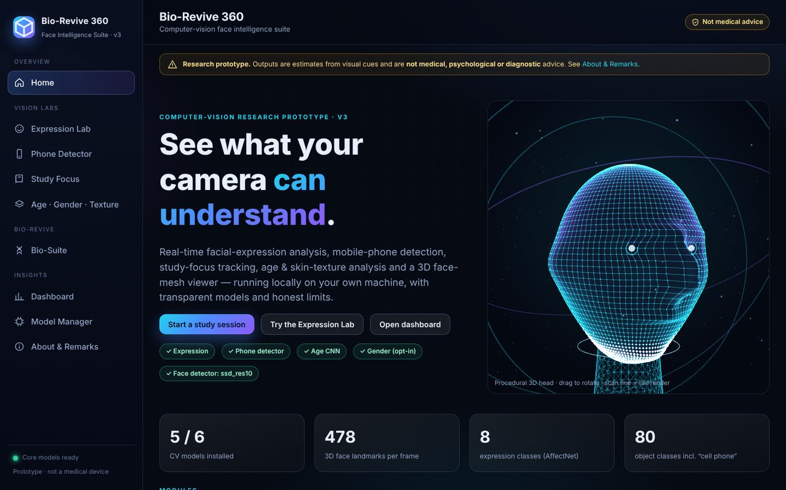

# Bio-Revive 360 — Face Intelligence Suite (v3.0)

A multi-page computer-vision web app **plus** standalone Python programs. Everything runs on your own machine.

> **Remarks — not medical.** This is a research / education **prototype**. It is **not a medical device** and does not
> diagnose, screen for, monitor or treat anything (no health, mental-health, fatigue, attention or skin conditions).
> Expression, attention, age, gender and skin-texture outputs are statistical estimates from images and can be wrong.
> Phenotypic Age is a published research equation, not a diagnosis. See the in-app **About & Remarks** page.



## What is inside

| Page (URL) | What it does |
|---|---|
| **Home** `/` | 3D hologram head (Three.js), capabilities, module cards, pipeline, remarks |
| **Expression Lab** `/expression` | Live camera or photo upload: happy / sad / angry / surprised / fearful / disgusted / contempt / neutral with probabilities, smoothing, timeline, group photos |
| **Phone Detector** `/phone` | YOLOv4-tiny finds mobile phones live or in photos; alert + log; sensitivity & input-size controls |
| **Study Focus** `/study` | Attention proxy from head pose + eyes + gaze + expression + phone use; gauge, timeline, blink/yawn counters, pomodoro, alerts, live 3D head mesh, session report (JSON/CSV) |
| **Age · Gender · Texture** `/attributes` | Apparent age (CNN), optional gender guess, LBP / Gabor / edge texture maps, regional metrics, skin tone (ITA), 3D relief view |
| **Bio-Suite** `/biosuite` | The original tools: profile, face scans, **Phenotypic Age** from 9 blood markers (Levine 2018), history, PDF report |
| **Dashboard** `/dashboard` | KPIs, attention timeline, state & expression mix, bio-age comparison, **snapshot image gallery**, 3D renders, system status |
| **Model Manager** `/models` | Download / verify / repair models, add any model URL |
| **About & Remarks** `/about` | Limits, privacy, responsible use, model cards, how the attention proxy works |

## Standalone Python programs (`programs/`)

| Program | Purpose |
|---|---|
| `expression_detector.py` | Detect facial expressions (happy, sad, …) from webcam / video / image (`--tiles` for group photos) |
| `phone_detector.py` | Detect mobile phones; beeps, logs to `outputs/phone_log.csv`, optional frame saving |
| `study_focus_monitor.py` | Is the person actively studying? Fuses expression + head pose + eyes + phone; prints/saves a session report |
| `gender_detector.py` | Optional apparent-gender guess (needs `--accept-limits`; read its warning) |
| `age_texture_analyzer.py` | Age + facial texture + skin tone from a photo; saves a 4-panel analysis image |
| `train_texture_model.py` | Train texture-feature **age / gender** models (NumPy) on your labelled data (UTKFace-style); `--synthetic N` self-test |

```bash
python programs/expression_detector.py                      # webcam, q / Esc to stop
python programs/phone_detector.py --image room.jpg --size 1024
python programs/study_focus_monitor.py --minutes 25
python programs/age_texture_analyzer.py --image face.jpg
python programs/train_texture_model.py --task age --data path/to/UTKFace
```
Windows: `RUN_PROGRAMS_WINDOWS.bat` is a menu for all of them.

## Models (all downloaded once, SHA-256 verified)

| Model | Task | Notes |
|---|---|---|
| OpenCV SSD ResNet-10 | face detection | tiled search finds small faces in group photos; Haar cascade fallback |
| MediaPipe FaceLandmarker | 478 3D landmarks (browser) | vendored WASM; the `.task` model file is fetched from Google's bucket or installed locally |
| EfficientNet-B0 (EmotiEffLib) | 8-class expression | trained on AffectNet (research / non-commercial terms — check before commercial use) |
| YOLOv4-tiny (COCO) | object / **cell phone** detection | bigger `--size` finds smaller phones |
| Levi–Hassner CNN | apparent age (8 groups) | |
| Levi–Hassner CNN | apparent gender (optional) | error-prone, binary, opt-in |
| Texture-feature models | age / gender | **you train them** (no weights ship); reported next to a trivial baseline |

`python -m app.download_models --list | --all | --verify | NAME --force | --add NAME URL --sha256 HEX`

## Install

Windows: unzip, double-click **`START_WINDOWS.bat`** (creates `.venv`, installs, downloads models, starts the server), open <http://127.0.0.1:8000>.
Manual (any OS, Python 3.10–3.14):
```bash
python -m venv .venv && source .venv/bin/activate     # Windows: .venv\Scripts\activate
pip install -r requirements.txt
python -m app.download_models
uvicorn app.main:app --reload
```
Optional: `pip install -r requirements-full.txt` (adds `mediapipe` for full mode in the command-line study monitor, and pytest).
**OpenCV must be 4.x** (OpenCV 5 dropped the Caffe loader the age/gender/face networks use). Camera access needs `localhost` or HTTPS.

## Full mode vs limited mode (Study Focus)
* **Full mode** — the browser's MediaPipe landmarker supplies 478 landmarks: head pose, eye-aspect ratio (blinks / closure / PERCLOS cue), yawns, gaze.
* **Limited mode** — no landmarks (model not downloaded / offline): only presence, expression and phone are available, so the app **cannot report "Focused"** (score capped).
  Fix: Model Manager → *MediaPipe Face Landmarker* → Install (or let the browser fetch it from Google's bucket).

## What was verified (and what was not)
**Verified in this build** (35 automated tests + browser runs with a headless Chromium):
* Phenotypic Age equation, unit conversion and rejection of unit mix-ups; full API / DB flow; PDF report.
* Head-pose math recovers 8 known rotations exactly, with a *physically* checked sign convention; EAR / MAR; engagement scenarios (focused, head turned, looking down, eyes shut, phone, away, blinks, yawns, time attribution).
* Real models on real images: expression (smiles → Happiness; cross-checked cv2.dnn vs onnxruntime), YOLO phone (found a phone in a group photo at 44 %), 6/6 faces found in a group photo with tiling, age CNN, texture maps.
* Every page loads with no JavaScript errors; upload flows; live camera loop using a fake webcam fed with a real face; full landmark mode via injected synthetic landmarks (frontal → *Focused 92*, head turned 45° → *Distracted 24*); original Bio-Suite flow.
* Downloader: resume, checksum mismatch rejection, corruption repair, custom models.

**Not verified / known limits — please read**
* The real **MediaPipe landmarker model could not be downloaded in the build sandbox**, so full mode was tested with synthetic landmarks, not a real tracked face. `programs/study_focus_monitor.py` full mode (python `mediapipe`) is likewise untested with the real model; its basic mode was tested.
* The Windows `.bat` launchers could not be run on Windows here (their logic was written to avoid the Python-version mismatch seen in v2.0).
* **Phone detection**: tested on one group photo and a portrait. YOLOv4-tiny missed a small phone at its default size, and gave a weak false positive (0.31) on a helmet area — hence the default threshold of 0.40 and the 2-frame confirmation. It has not been benchmarked on phone-in-hand video.
* **Expression** over-reads serious neutral faces as anger/contempt (seen in the test photo). **Gender** misjudged a test photo of a woman (97 % "male-presenting"). **Age** is a coarse bucket model. None of these were benchmarked for accuracy or fairness.
* **Texture-feature age/gender models** are untrained here (no dataset was available); their trainer was validated only on synthetic data.
* The attention score is a rule-based proxy, not a validated measure of learning or attention.

## Privacy
Inference is local; live frames are discarded; only explicit **Save snapshot** clicks store a JPEG (metadata stripped) under `data/snapshots`; study sessions store summaries in SQLite. There is **no authentication** — do not expose the server to a network without adding it. Check biometric / face-analysis laws (e.g. GDPR, US state biometric statutes) before any real deployment, and never use it to grade, rank or monitor other people.

## Layout
```
app/            FastAPI app, DB models, model registry + downloader, vision_api.py, report PDF
app/vision/     faces · expression · phone · attributes (age/gender) · texture · texture_ml · pose · engagement · pipeline
app/static/     pages (*.html), css/, js/ (core.js, holo.js 3D), vendor/ (three, chart.js, mediapipe), img/ (3D renders)
programs/       standalone command-line programs
tests/          pytest suite
docs/screenshots/
```
API docs: <http://127.0.0.1:8000/docs> · Tests: `pytest -q tests`.

## Roadmap ideas
Blendshape micro-expression cues · per-user attention calibration · posture / speech cues · fairness evaluation on a balanced dataset · calibrated uncertainty · encrypted storage + accounts · WebRTC remote analysis.
